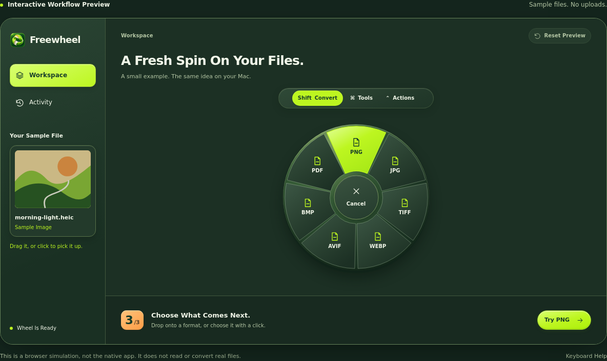

<p align="center"></p>

# Lemulip

**File Tools, Right Where You Drag.**

Lemulip is a free, open-source file converter for macOS. Start dragging a file, tap a key, and drop it onto a format or tool. Convert a photo, merge PDFs, trim a clip, or make a ZIP without opening a different app for each job.

Files are processed on your Mac. No account, subscription, uploads, or analytics.

[Get Started](#get-started) · [User Guide](docs/USER_GUIDE.md) · [Formats](docs/FORMATS.md) · [FAQ](docs/FAQ.md) · [Roadmap](docs/ROADMAP.md) · [Design](docs/DESIGN.md)

## Get Started

**Lemulip is an early public preview for macOS 13 or later.** Finder drag compatibility and the full desktop workflow still need hands-on testing.

Source **0.1.7** adds a visual PDF organizer alongside the native image, audio, and video editors. [Releases](https://github.com/osmankaankars/lemulip/releases) lists available downloads; each version must pass its own Mac checks before its archives are published.

### Download the App

Open [Releases](https://github.com/osmankaankars/lemulip/releases) and choose the **macOS universal DMG** under **Assets**. Drag **Lemulip** into **Applications**. The app ZIP also includes the `lemulip` command-line tool. These downloads run on Apple silicon and Intel without installing Xcode or Swift.

Each release must pass [Build and Verify](https://github.com/osmankaankars/lemulip/actions/workflows/build.yml), including checks of the exact packages on both architectures. Preview packages use ad-hoc signing, without Apple Developer ID signing or notarization; see [First Launch](docs/INSTALL.md#signing-and-first-launch).

### Build From Source

You need **Swift 5.9 or later** from compatible Xcode Command Line Tools or full Xcode.

Download the source, extract it, and run this in the Lemulip folder:

```bash
./Build-and-Install.command
```

The script builds Lemulip and installs it in your account's `Applications` folder. If an app is already there, it keeps that installation and puts the new build in `dist/Lemulip.app`.

Missing developer tools? Run `xcode-select --install` first. For full Xcode selection, release packages, and first-launch help, see [Installation](docs/INSTALL.md).

## A Wheel for the Files in Your Hand

1. Start dragging one or more local files.
2. Tap **⇧ Shift** for formats, **⌘ Command** for tools, or **⌃ Control** for file actions.
3. Drop onto the operation you want.

You can release the modifier key while you keep dragging. The center cancels; a drop outside the wheel submits no conversion. Tools with options open an editor or settings panel before the job starts.



<!-- LEMULIP_DEMO_LINK_START -->
[Open the Browser Walkthrough](https://osmankaankars.github.io/lemulip/) · This is an interactive simulation with sample files; the Mac app performs conversions.
<!-- LEMULIP_DEMO_LINK_END -->

Prefer a window? Add files with **⌘O**, drop them into the workspace, or choose **Open With → Lemulip**. Reorder a selection before merging PDFs or combining images into a PDF. The same tools are available there, alongside a job queue, Activity, and a floating file shelf.

## What Can It Do?

| Work With | Examples |
| --- | --- |
| Images | PNG, JPEG, HEIC, TIFF and BMP; visual crop, resize, rotate, remove metadata; images to PDF |
| PDFs | Visual page organization; reorder, rotate, remove, extract, merge, split, export pages as images, extract text, offline OCR |
| Audio | Waveform trim with selection playback; M4A, WAV and AIFF export; more formats with optional FFmpeg |
| Video | Native conversion, visual trim and crop, MP4/MOV export; more tools and codecs with optional FFmpeg |
| Documents and tables | Microsoft Word (DOCX), Excel (XLSX), PowerPoint (PPTX), text, CSV ↔ TSV, and subtitles; some routes need an optional local engine |
| Archives | Create ZIP and TAR, GZIP individual files, extract supported archives into a new folder |
| File actions | AirDrop, floating shelf, copy, move, copy path, open the containing folder in Terminal |

Formats depend on the input, installed engines, and available codecs. [The format guide](docs/FORMATS.md) lists supported routes and fidelity limits.

## See What You Keep

Open **Tools → Crop** with a single image. Move the selection, drag any of its
eight handles, or choose an aspect ratio. Exact pixel dimensions and keyboard
movement help with the last adjustment. **Create Copy** crops the original
resolution and leaves your source file in place.

The editor prepares a bounded preview in the background. Its first version
supports one still raster image at a time, up to 40 megapixels and 16,384 pixels
per side. See [Visual Image Crop](docs/USER_GUIDE.md#visual-image-crop) for controls
and format limits.

## Hear What You Keep

Open **Tools → Trim** with one audio file. Move the start and end handles on
the waveform, enter precise timestamps, and use **Play Selection** to listen
before saving. **Create Copy** exports the chosen range as M4A, WAV, or AIFF.

The waveform is prepared in bounded chunks, without keeping a full decoded
recording in memory. This editor uses native macOS decoding and playback;
unsupported inputs receive an explanation before editing. Read
[Audio Waveform Trim](docs/USER_GUIDE.md#audio-waveform-trim) for controls and
encoding limits.

## Watch What You Keep

Open **Tools → Trim** with one
video. Watch the native preview, use the thumbnail strip to find your range,
and adjust its start and end handles or timestamps. **Play Selection** previews
the chosen section; **Create Copy** saves it as MP4 or MOV.

The editor keeps a fixed number of small thumbnails and uses macOS playback
and export without an extra conversion engine. Supported inputs depend on
macOS codecs; export re-encodes the range and keeps the original file in place. Read
[Visual Video Trim](docs/USER_GUIDE.md#visual-video-trim) for controls and limits.

## Frame It Your Way

Open **Tools → Crop** with one video. Move the crop, choose an aspect ratio,
and check the output dimensions while you preview the clip. **Create Copy**
applies that frame to the whole video and saves a new MP4 or MOV.

Video cropping starts with source **0.1.6**. It uses native macOS tools and
keeps the original file in place. Crop and trim are separate operations; read
[Visual Video Crop](docs/USER_GUIDE.md#visual-video-crop) for controls and output
limits.

## Put Every Page in Place

Open **Tools → Organize** with one PDF. See its pages as thumbnails, drag them
into order, rotate a selection, or remove pages from the copy. **Undo** and
**Reset** let you change your mind before saving. Use **Extract Selected** for a
smaller PDF or **Create Copy** for the full arrangement.

The organizer copies the original PDF pages, keeping their text and vector
content. Only previews are rendered as images, and the original file stays in
place. See [Organize PDF](docs/USER_GUIDE.md#organize-pdf) for controls and document
limits.

## Make It Yours

Choose **Orchard Night**, **Vivid Pistachio**, or **Lemon Drop** in
**Settings → Appearance → Theme**. Orchard Night is the default. Lemulip remembers
your choice and applies it across the workspace, wheel, and editors.

Try the same three appearances in the browser walkthrough. The walkthrough
uses sample files; it does not perform conversions or run the native editors.

## Start With What Is Built In

Common image tools, PDF tools, OCR, archives, subtitles, and basic text conversion work without extra engines.

For more formats, install only what you need:

```bash
brew install ffmpeg imagemagick
brew install --cask libreoffice
```

These commands require [Homebrew](https://brew.sh). For Pandoc, use its [official macOS installer](https://pandoc.org/installing.html), which includes the templates needed by Lemulip's restricted document conversion.

Open **Settings → Local Engines → Refresh** afterward. Lemulip does not download helpers automatically. Installing engines needs internet access; conversion runs locally.

DOCX, XLSX, and PPTX are Microsoft Office file formats. LibreOffice handles some of these conversions in the background; you can open the results in Word, Excel, or PowerPoint. Microsoft Office does not need to be installed for those routes. See [Office Formats](docs/FORMATS.md#documents-slides-and-spreadsheets) for the supported input and output combinations.

## Your Originals Stay Yours

Conversions create new files. Existing names get an unused suffix, such as `photo (2).png`. By default, a job saves every output beside the first selected file. Turn off **Save in the First File's Folder** to choose a destination each time.

**Move To…** deliberately moves the selected originals. PDF compression creates a flattened copy and removes searchable text, links, forms, and other PDF structure from that copy. The app asks you to acknowledge this before proceeding.

Activity lasts for the current session. Only preferences are saved. AirDrop shares files when you choose it.

## Use the Same Engine in Terminal

```bash
swift run lemulip convert png photo.heic
swift run lemulip run pdf.merge first.pdf second.pdf
swift run lemulip run media.trim clip.mp4 --start 5 --end 25
swift run lemulip engines
```

Use `swift run lemulip --help` for options, or see the [CLI Guide](docs/USER_GUIDE.md#command-line-use).

## Help Shape the Next Release

Try a small, non-sensitive file and tell us what worked or failed. Good reports include the input format, chosen operation, macOS version, and exact error. [Contributing](CONTRIBUTING.md) covers bug reports and focused changes.

The [roadmap](docs/ROADMAP.md) prioritizes reliable releases, visual editing, a warmer interface, and measurable limits on app size and idle resource use.

## Contributors

Created and maintained by **[Kaan Kars](https://github.com/osmankaankars)**.

Contributions are welcome. See [Contributing](CONTRIBUTING.md) for bug reports, improvements, and development guidance.

Lemulip is MIT licensed. Its drag-wheel workflow was inspired by [Tangerine](https://tangerineformac.com).

[License](LICENSE) · [Third-Party Notices](THIRD_PARTY_NOTICES.md) · [Security](SECURITY.md) · [Release Notes](docs/RELEASE_NOTES.md)
