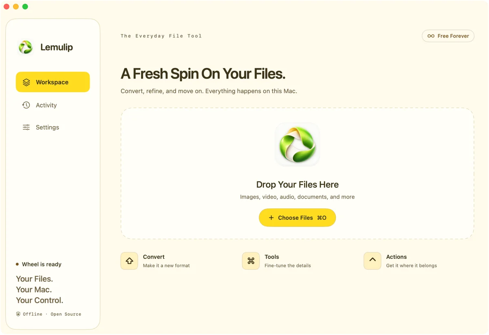

# Lemulip

**Less File Work. More Flow.**

Free, open-source file tools for macOS. Drag a local file on your desktop or in Finder, tap a key, and choose an operation. Processing stays on your Mac.

**35 Conversion Output Formats · 26 File Tools · 6 File Actions**

Includes built-in and optional local engines.

[Download For Mac](https://github.com/osmankaankars/lemulip/releases) · [Website](https://osmankaankars.github.io/lemulip/)

## Install

**macOS 13+ · Apple Silicon & Intel · 0.1.16 Public Preview**

Open the release DMG and drag Lemulip into Applications. The app ZIP also includes the command-line tool. [Installation and optional engines](docs/INSTALL.md).

## File Tools

| Files | Operations |
| --- | --- |
| Images | Convert, crop, resize, rotate, remove metadata |
| PDFs | Organize, merge, split, extract, rotate, offline OCR |
| Audio & Video | Trim, crop video, convert and extract audio |
| Documents & Tables | Word and Excel export, document and spreadsheet conversions |
| Subtitles & Archives | SRT/VTT conversion, ZIP/TAR creation, GZIP and extraction |

Tap **⇧ Shift** for formats, **⌘ Command** for tools, or **⌃ Control** for actions while dragging. Workspace is also available for file selection and jobs.

## Local Engines

Common tools are built in. Optional **FFmpeg**, **ImageMagick**, **LibreOffice**, and **Pandoc** extend media, image, and document support. Engines are installed separately, not bundled. Refresh detection in **Settings → Local Engines** after installation.

[User Guide](docs/USER_GUIDE.md) · [Formats](docs/FORMATS.md) · [Development](docs/DEVELOPMENT.md) · [Release Notes](docs/RELEASE_NOTES.md)

Created by [Kaan Kars](https://github.com/osmankaankars). [MIT License](LICENSE) · [Third-Party Notices](THIRD_PARTY_NOTICES.md) · [Security](SECURITY.md)
