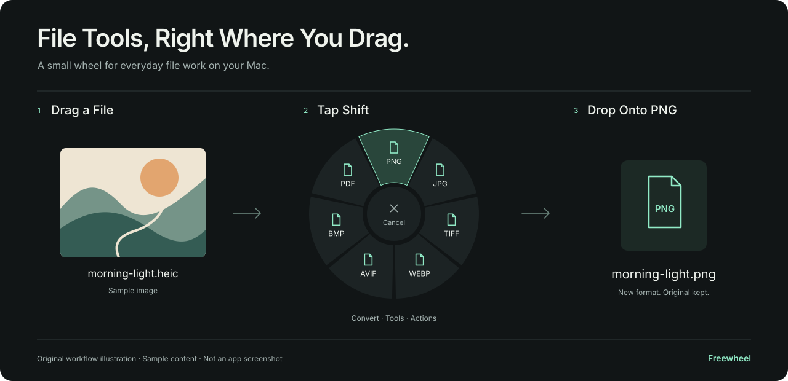

# Using Lemulip

Lemulip has three ways to work: a wheel beside your drag, a regular workspace, and a command-line tool. They share the same conversion engine.

New here? [Install Lemulip](INSTALL.md) first. For specific input and output combinations, use the [format guide](FORMATS.md).

This guide follows source **0.1.14**, including the HTML → Word repair and
separate HTML and Markdown checks, alongside native basic RTF, plain-text Word,
and text-cell Excel exports. Visual image
crop and audio waveform trim start with 0.1.4, native video trim with 0.1.5,
visual video crop with 0.1.6, Organize PDF with 0.1.7, and Merge PDF preview with 0.1.8.
Check [Releases](https://github.com/osmankaankars/lemulip/releases) for available
downloads and the notes for your installed version.

## Your First Conversion

Open Lemulip and add a small image with **⌘O**. Choose **Convert**, then a different format, such as PNG for a JPEG input. When the job finishes, open **Activity** and click its output to reveal it in Finder.

The original stays in place. The new file is saved in the first selected file's folder unless you change the output preference.

## The Drag Wheel



With Lemulip running, begin dragging a local file in Finder. Press a modifier after the drag starts:

| Key | Menu | Typical Use |
| --- | --- | --- |
| **⇧ Shift** | Convert | Pick a new format |
| **⌘ Command** | Tools | Resize an image, split a PDF, trim media |
| **⌃ Control** | Actions | Copy, move, AirDrop, or open a file shelf |

Drop onto a segment to choose it. Releasing the modifier alone keeps the wheel open. The center is a cancel area. A drop outside the wheel submits no conversion, although the app underneath may handle that drop.

The menu follows the selected file types. Selecting unrelated types together may leave only archive tools and file actions. Scroll over the wheel to move through additional pages when available.

The current keys are fixed. You can pause the wheel using **Drag Wheel Enabled** in the menu bar, or **Settings → Drag Wheel**.

Finder drag behavior is still being tested across Mac setups and source applications. If a drag is not recognized, use the workspace.

## The Workspace

Use **Add Files**, **⌘O**, or drag files into the main window. You can also use Finder's **Open With → Lemulip**.

Choose **Convert**, **Tools**, or **Actions** above the operation cards. Removing a file from this selection does not delete it from disk. **Clear** empties the selection.

For jobs where order matters, use the up and down arrows beside each file. This
order becomes the starting arrangement in the PDF merge preview and controls
the page order when combining images into a PDF. The merge editor lets you
review and change its arrangement before creating the copy.

**Open Wheel** opens a clickable version of the wheel for the current selection. In this mode:

| Control | Action |
| --- | --- |
| Arrow keys | Select an operation |
| Return | Choose the selected operation |
| Tab | Cycle Convert, Tools, and Actions |
| Page Up / Page Down | Change the menu page |
| Escape | Close the wheel |

## Choose a Theme

Open **Settings → Appearance → Theme** and select a named swatch:

- **Orchard Night:** deep green with vivid lime accents; the default.
- **Vivid Pistachio:** warm ivory with bright pistachio accents.
- **Lemon Drop:** warm cream with lemon-yellow accents.

The theme updates the workspace, option panels, wheel, file shelves, and native
controls, and is remembered the next time you open Lemulip. Your current file
selection and job progress stay in place when you change it.

The browser walkthrough has its own **Appearance** selector. Its selection is
saved locally when browser storage is available. Sample files and demo activity
are kept only for the current page session.

## Set Options Before a Job

Some operations run as soon as you select them. Others open a panel with relevant settings and a **Create Copy** button.

| Tool | What to Set |
| --- | --- |
| Compress | Quality; PDF compression also has a maximum dimension |
| Resize | Maximum dimension in pixels; keeps the aspect ratio and does not enlarge smaller images |
| Crop Image | Visual selection, aspect ratio, and exact pixel dimensions for one image |
| Crop Video | A crop over the video preview, aspect ratio, and output dimensions for the whole clip |
| Rotate | 90°, 180°, or 270° clockwise |
| Trim Audio | Waveform handles, timestamps, selected-range playback, and an output format |
| Trim Video | Native preview, thumbnail strip, range handles, timestamps, selected-range playback, and MP4/MOV output |
| Organize PDF | Page thumbnails, ordering, rotation, removal, and extraction for one PDF |
| Merge PDF | First-page previews, document order, page counts, and output page ranges for several PDFs |
| Extract PDF Pages | Page numbers and ranges, such as `1,3-5,8` |
| Change Speed | Playback multiplier from 0.5× to 4× |
| Adjust Volume | Level from 0% to 300% |

PDF page numbers start at 1. Crop dimensions must fit within the source. Image
crop, audio waveform trim, video trim, and video crop use native macOS tools. Other
desktop media tools, such as compression, resizing, speed, and volume, require
FFmpeg.

### Visual Image Crop

Select one image, choose **Tools → Crop**, and wait for its preview to appear.
The original dimensions are shown above the canvas. Nothing is written while
you adjust the selection.

| Control | Action |
| --- | --- |
| Drag inside the selection | Move the crop without changing its size |
| Drag a corner or edge handle | Resize the crop; all eight handles stay inside the image |
| Drag in the dimmed area | Draw a new selection |
| **Aspect Ratio** | Choose Free, Original, 1:1, 4:3, 3:4, 16:9, or 9:16 |
| **Width / Height** | Enter exact output dimensions in pixels; this switches to Free |
| Arrow keys with the canvas focused | Move by one pixel; hold Shift for ten pixels |
| **Show Grid** | Show or hide the thirds grid |
| **Reset** | Select the full image and return to Free |
| **Cancel** or Escape | Close the editor without creating a file |
| **Create Copy** | Queue the crop through the normal output workflow |

Tab moves between the canvas and the controls. The canvas shows a focus border,
announces the crop dimensions and position to assistive technology, and offers
accessible move actions. Fixed ratios round to whole pixels.

The preview is limited to 1,600 pixels on its longest edge. Export reads the
original image and applies the selection at its full resolution, with the same
orientation as the preview. Transparent areas use a checkerboard in the editor;
output transparency depends on the image format. JPEG, for example, has none.

This first editor supports a single still raster that macOS can decode and
write. Multiple files, animated or other multi-frame images, SVG, and unavailable
codecs show an explanation instead of choosing an arbitrary frame or changing
the selected region. Convert an unsupported input to a still PNG first when
that is appropriate for your task. The original raster must fit within
40 megapixels and 16,384 pixels per side. Cancel while the preview is loading
to discard the request.

The command-line `image.crop --width … --height …` command keeps its existing
centered-crop behavior. Use the desktop editor to choose a different position.

### Audio Waveform Trim

Select one audio file and choose **Tools → Trim**. The editor reads a waveform
summary in the background; you can cancel while it loads. Once the waveform
appears, adjust the range and listen before making a copy.

| Control | Action |
| --- | --- |
| Drag Start or End | Change the corresponding boundary without crossing the other handle |
| Drag inside the selection | Move the range while keeping its duration |
| Click outside the selection | Move the nearest boundary to that position |
| **Start / End** | Enter seconds, `MM:SS.mmm`, or `HH:MM:SS.mmm`; a decimal comma also works |
| **Selected Duration** | Read the amount of audio the range keeps |
| **Play Selection** | Play from Start and stop at End |
| **Pause** | Stop the current preview; Play Selection starts the range again |
| **Save As** | Choose an available M4A, WAV, or AIFF encoder |
| **Reset** | Select the full recording |
| **Cancel** or Escape | Close the editor, cancel its preview request, and stop playback |
| **Create Copy** | Stop playback and queue the chosen range for export |

With the waveform focused, **S** selects the start handle and **E** selects the
end handle. Left and right arrows move that handle by 0.01 seconds; hold Shift
for one second. Space plays or pauses. Tab moves to the other controls, and
accessible actions offer the same boundary adjustments. Invalid timestamps
disable playback and Create Copy until corrected.

Selections are at least 10 milliseconds long. A shorter recording can be kept
in full. The fields show milliseconds, while opening a file and using Reset
preserve its exact end even when it falls between displayed milliseconds.
Changing the range stops playback so the next preview uses the new selection.

| Output | Encoding |
| --- | --- |
| M4A | Re-encodes the selected audio as AAC; the encoder can add padding at its boundaries |
| WAV | Writes uncompressed 16-bit PCM; boundaries follow decoded audio samples |
| AIFF | Writes uncompressed 16-bit PCM in an AIFF file; boundaries follow decoded audio samples |

WAV and AIFF can be larger than a compressed source. Changing an MP3 to PCM
does not restore detail already lost in the source. For sample-oriented edits,
use WAV or AIFF; compressed output is not a promise of sample-exact duration.
The original file remains unchanged, and the normal unused-name output rules
apply to every format.

This first waveform editor supports one native-decodable mono or stereo audio
track at 8–192 kHz. Multiple selected files, unsupported channel layouts, and
unavailable codecs receive an explanation. Convert other inputs to a compatible
WAV or M4A first; the optional FFmpeg engine can help with additional formats.
The editor itself does not decode through FFmpeg or mix multiple tracks.

The waveform is an overview, not a full-resolution audio buffer. The editor
requests 1,200 peak values and keeps only bounded decoding chunks while reading
the file. No temporary decoded recording or persistent waveform cache is made.
CLI trimming retains its numeric start/end workflow.

### Visual Video Trim

**Native video trim starts with 0.1.5.** Check [Releases](https://github.com/osmankaankars/lemulip/releases)
for downloadable builds. Select one video and choose **Tools → Trim**. The editor opens a native player and
prepares a small thumbnail strip in the background. Nothing is written while
you choose a range.

| Control | Action |
| --- | --- |
| Drag Start or End | Change a boundary without crossing the other handle |
| Drag inside the selection | Move the range while keeping its duration |
| Click the thumbnail strip or scrub its ruler | Move the preview playhead within the selected range |
| **Start / End** | Enter seconds, `MM:SS.mmm`, or `HH:MM:SS.mmm`; a decimal comma also works |
| **Selected Duration** | Read the amount of video the range keeps |
| **Play Selection** | Play from the current playhead and stop at End; after reaching End, start the range again |
| **Pause** | Pause the preview at its current position |
| **Go to Selection Start** | Return the paused preview to the beginning of the selected range |
| **Save As** | Choose an available MP4 or MOV export |
| **Reset Selection** | Select the full clip |
| **Cancel** or Escape | Close the editor, cancel unfinished preview work, and stop playback |
| **Create Copy** | Stop playback and queue the selected range for export |

With the timeline focused, **S** selects the start handle, **E** the end handle,
and **P** the playhead. Left and right arrows move the active control by
0.01 seconds; hold Shift for one second. Space plays or pauses. Tab moves to
the other controls, and accessible actions offer the same adjustments. Invalid
timestamps disable playback and Create Copy until corrected.

Changing a boundary pauses playback and previews the changed edge without
starting playback again. The fields show milliseconds; opening a file and using
Reset Selection preserve its exact end even when it falls between displayed
milliseconds. Both range handles and typed timestamps keep at least 10
milliseconds, or the full clip when shorter. Previewing End shows the last
included frame while the selected end time stays unchanged.
The native preview respects the source's display orientation and fits it within
the editor instead of stretching it.

The editor requests 12 thumbnails at most 192 pixels on their longest edge.
They provide a navigation overview, not a frame-by-frame editing track. The
preview worker is cancelled when the editor closes; thumbnails are not saved
as a persistent cache.

MP4 and MOV export re-encode the chosen range using the native presets available
for the source. Video-frame and audio-codec boundaries can affect the exact
output duration. This is not a lossless or frame-exact editing guarantee.
The output keeps the source orientation. The original remains unchanged and
the normal unused-name output rules apply.

This first editor accepts one complete local file containing one native-decodable
video track and at most one audio track. The file must contain its own media;
external media references are rejected. Multiple files, unsupported codecs, and
protected or live media also receive an explanation. The editor does not mix
tracks or silently switch to FFmpeg. Subtitle and professional media metadata
preservation are outside this first editor's scope. Convert an unsupported input
to a compatible MP4 or MOV first when appropriate; optional FFmpeg provides
additional conversion routes.

The command-line `media.trim --start … --end …` workflow remains numeric.
Use the desktop editor to preview and adjust a range visually.

### Visual Video Crop

**Video crop starts with 0.1.6.** Check
[Releases](https://github.com/osmankaankars/lemulip/releases) for downloadable
builds. Select one video and choose **Tools → Crop**. The editor shows an
upright frame while native playback prepares, with the crop laid over the video.

| Control | Action |
| --- | --- |
| Drag inside the selection | Move the crop without changing its size |
| Drag a corner or edge handle | Resize the crop inside the video frame |
| **Aspect Ratio** | Choose Free, Original, 1:1, 4:3, 3:4, 16:9, or 9:16 |
| **Width / Height** | Enter even output dimensions in pixels; this switches to Free |
| **Left / Top** | Read the crop's position within the upright source frame |
| **Show Grid** | Show or hide the thirds grid |
| **Play Video / Pause** | Preview the full clip through the crop overlay |
| Seek slider | Choose another moment without changing the crop |
| **Go to Start** | Return the paused preview to the beginning |
| **Reset Crop** | Return to the largest crop that fits the source |
| **Save As** | Choose an available MP4 or MOV export |
| **Cancel** or Escape | Close the editor, cancel preview work, and stop playback |
| **Create Copy** | Queue the full clip with the selected crop |

With the crop canvas focused, arrow keys move it by one source pixel; hold
Shift for ten pixels. Space plays or pauses, and Tab moves to the other controls.
Editing the crop pauses playback so you can check the adjustment. The visible
selection, output dimensions, and keyboard movement use the same upright frame.

The output is at least 2 × 2 pixels, with even width and height for video
encoding. Dragging or choosing a ratio snaps to those dimensions; the fields
show the crop that will be exported. On a source with odd dimensions, the
largest crop leaves at most one pixel at the right or bottom. Pixels are cropped,
not stretched to fit an encoder. Output is limited to 40 megapixels and
16,384 pixels per side; choose a smaller crop if the full source exceeds that.

**The same crop applies to the whole clip.** It keeps the source audio and
exports a new MP4 or MOV. To shorten the clip as well, finish one operation and
open the resulting copy in **Trim**. Crop does not silently reuse a previous
trim selection. Export re-encodes video and can change its codec or color
representation; codec timing can leave a small duration difference. It is not
a lossless edit.

This first crop editor accepts one complete local video file containing its own
media, with one video track and at most one audio track. Ordinary landscape and
portrait rotations are supported. Mirrored, scaled, or sheared display transforms,
non-square pixels, and a custom clean aperture need conversion to a standard
video first. The [format guide](FORMATS.md#audio-and-video) lists these limits.
Unsupported files receive an explanation before a crop runs.

The fallback still preview is capped at 1,280 pixels on its longest edge; export
reads the original video frames. The player exists only while the editor is
open, and closing it cancels preview work and releases playback resources. No
persistent frame cache is created. Completed outputs use the normal unused-name
rules, and the original file stays in place.

### Organize PDF

**Organize PDF starts with 0.1.7.** Select one PDF and choose
**Tools → Organize**. Pages appear as small previews. Each card shows its current
position and **Original Page** number so you can identify it after reordering.

| Control | Action |
| --- | --- |
| Click a page | Select that page |
| Command-click | Add or remove one page from the selection |
| Shift-click | Select a range of pages |
| Drag selected pages | Move the selection to another position |
| **Move Earlier / Move Later** | Move the selected pages toward the beginning or end |
| **Rotate Left / Rotate Right** | Turn selected pages by 90° |
| **Remove** | Leave selected pages out of the new copy |
| **Undo** | Revert the last arrangement change |
| **Redo** | Reapply an undone change |
| **Reset** | Restore the original page order, rotations, and full page list |
| **Extract Selected** | Queue only the selected pages, in the current displayed order |
| **Create Copy** | Queue every remaining page, in the current displayed order |
| **Cancel** or Escape | Close without exporting |

With the page grid focused, use arrow keys to select pages, hold Shift to extend
the selection, and press Delete to remove it from the copy. **⌘A** selects all
pages; **⌘Z** undoes an edit and **⇧⌘Z** redoes it. Use **⌥⌘← / ⌥⌘→** to move
the selection and **⌘L / ⌘R** to rotate it left or right. Tab moves between the
other controls.

Removing a page here changes only the pending copy. It does not delete a page
from the original file. The editor keeps at least one page; select pages before
using a selection action. Rotations apply to the page's current orientation,
including pages that were already rotated in the source.

The new PDF uses the original pages, keeping their text, vector content, and
page annotations. It is not made from the thumbnails. Document-level features such as bookmarks,
links between pages, form relationships, signatures, and accessibility structure
are not guaranteed to remain valid after pages are moved or removed. Use the
original for work that depends on those features. The ordinary **Extract Pages**
tool remains available for entering page numbers and ranges directly.

There is no password field. Locked PDFs and documents that do not permit
copying and page organization receive an explanation. An encrypted PDF that
opens without a password can be organized when those permissions allow it;
the editor explains before export that **the new copy will not be password
protected**. The original keeps its existing protection.

The editor supports one local PDF with up to **1,000 pages** and a source size
of **512 MiB**. Previews load as pages come into view; the thumbnail cache holds
at most 24 images, each at most 320 pixels on its longest edge. A temporary
source copy keeps the preview consistent while you work and is removed when the
editor closes. If the source changes before export, reopen the editor to use
the updated document. Completed PDFs follow the normal output-folder and
unused-name rules.

### Merge PDF

**Merge PDF preview starts with 0.1.8.** Select two or more PDFs and choose
**Tools → Merge PDFs**. The editor inspects the documents with visible progress,
then shows them in the order you selected in the workspace.

Each row shows the filename, a first-page preview, the document's page count,
and **Pages A–B in Your Copy**. **Original File** identifies its position in the
starting selection, even after you move it. The summary shows how many PDFs
and pages will be included. Page ranges and totals update as the arrangement
changes.

| Control | Action |
| --- | --- |
| Click a document | Select that document |
| Command-click | Add or remove one document from the selection |
| Shift-click | Select a range of documents |
| Drag selected documents | Move them together, keeping their relative order |
| **Move Earlier / Move Later** | Move selected documents toward the beginning or end |
| **Remove** | Leave selected documents out of the pending copy |
| **Select All** | Select every remaining document |
| **Undo / Redo** | Revert an arrangement change or reapply it |
| **Reset** | Restore the complete starting file list and its order |
| **Create Copy** | Queue one PDF containing every page from the retained documents |
| **Cancel** or Escape | Close without exporting |

With the document list focused, use Up and Down to select a row and hold Shift
to extend the selection. **⌘A** selects all documents, Delete removes the
selection, **⌘Z** undoes an edit, and **⇧⌘Z** redoes it. Use **⌥⌘↑ / ⌥⌘↓** to
move the selection. Tab moves between the other controls.

At least two documents must remain. **Remove** changes the pending merge and
leaves files on disk untouched. Every page within a document keeps its source
order and orientation. To rotate, remove, or extract individual pages, use
[Organize PDF](#organize-pdf) on that document first, then merge the saved copy.

The resulting PDF uses actual source pages, retaining text, vector content,
and page annotations. First-page images are only previews. Document-level
bookmarks, links between pages, form relationships, signatures, and accessibility
structure may not remain valid after files are combined; keep the originals
when those features matter.

The preview requires readable local PDFs with permission to assemble and copy
pages. There is no password field. Locked or restricted documents receive an
explanation before editing. If a retained document is encrypted but already
readable, the editor explains before export that **the new copy will not be
password protected**. Original document protection is unchanged.

Start with **2–100 PDFs**, each with up to **1,000 pages**, and no more than
**512 MiB of source files in total**. The new copy can contain at most
**1,000 pages**. If the initial page total is higher, remove whole documents
until the arrangement fits; at least two documents must still remain.

Previews use a shared cache of at most 24 small images, each at most 320 pixels
on its longest edge. Documents are inspected sequentially, and each temporary
source copy is removed after its inspection or preview work ends. Export makes
its own temporary source copies and checks that the retained documents still
match their previews. If one has changed, reopen the editor to use the updated
files. Export copies are removed on completion, failure, or cancellation.
These limits bound Lemulip's cache and source copies, not PDFKit's total memory.

With **Settings → Save in the First File's Folder** enabled, the completed PDF
is saved beside the first retained document in the displayed arrangement.
Moving or removing the first document changes that default folder. Turn the
setting off to choose a destination. Existing files are preserved with the
normal unused-name rule.

The command-line `pdf.merge` operation combines files in argument order without
opening the preview editor.

### PDF Compression

This tool renders pages as images in a new PDF. Text selection, links, forms, signatures, and accessibility structure are lost in the output. The original remains untouched, and some files may become larger.

Select **Create a Flattened Copy** only when that result suits your purpose. To keep editable or searchable content, use another PDF operation.

## Find Results and Manage Jobs

Conversion jobs run one at a time in a queue. **Activity** shows waiting, running, completed, failed, and cancelled jobs.

Use the cancel button for a queued or running conversion. A failed or cancelled conversion attempt removes its temporary staging files. Completed outputs are revealed with the file and folder buttons.

**Clear Finished** removes completed entries from Activity. It does not delete outputs. Activity is kept in memory and is cleared when the app quits.

### Choose an Output Folder

In **Settings**, leave **Save in the First File's Folder** on to save all outputs
of each job beside its first input. A visual PDF merge uses the first retained
document in the editor's displayed order. This also applies when inputs come
from different folders.

Turn it off to choose a destination for each job. Existing files are not replaced; Lemulip chooses a new name. **Reveal Finished Files** controls whether Finder opens automatically after success.

### File Actions

**Copy To…** and **Move To…** ask for a destination. Move relocates your selected originals. Both choose unused names. If a multi-file transfer stops partway through, completed transfers remain in place and are listed in Activity.

**Float** keeps the selected files in a small shelf above other windows. **Copy Path** copies their absolute paths to the clipboard. **Terminal** opens the first selected file's containing folder, or the folder itself when selected. **AirDrop** opens the system sharing flow when available.

## Basic Office Exports

TXT → DOCX and CSV/TSV → XLSX need no extra engine on macOS. Source **0.1.12**
adds basic RTF → DOCX with supported font and paragraph formatting. Microsoft
Office is not required for conversion.

### Create a Word Document

1. Add a **TXT** or basic **RTF** file to the workspace, or start dragging it in
   Finder.
2. Choose **Convert → DOCX** in the workspace, or press **Shift** while dragging
   and drop onto **DOCX** in the wheel.
3. When the job completes, reveal the new `.docx` file from **Activity**.

For TXT, the native macOS route keeps paragraphs, tabs, and Unicode. Save the
source as UTF-8 or BOM-marked UTF-16. TXT input must be between **1 byte and
32 MiB** and contain text beyond an
encoding marker. The output does not infer formatting from plain text. A heading
written as `# Notes` stays that text.
For formatted Markdown → DOCX, use a Markdown file with optional Pandoc.

For basic RTF, it keeps font families and sizes, bold and italic text, and
paragraph alignment, spacing, and indents. Each RTF file must also be between
**1 byte and 32 MiB** and contain text. Page layout and margins are not
reconstructed. Unavailable fonts may be substituted, and the application
opening the DOCX can change line breaks and pagination. Review the new document
before sharing it.

RTF with images, objects, tables, lists, fields, hyperlinks, headers, footers,
or other unsupported structures uses optional LibreOffice. Lemulip checks the
selection before creating native output; if any RTF needs that engine, the
whole selection follows the optional-engine route. Install LibreOffice and
refresh **Settings → Local Engines** if prompted. Malformed basic RTF receives
an error; LibreOffice validates documents assigned to its route. The basic
exporter does not silently flatten these richer features.

The native DOCX author and editor are set to **Lemulip**. Input document
metadata is not copied. HTML and existing Office documents continue to use the
optional engines listed in [Formats](FORMATS.md#documents-slides-and-spreadsheets).

### Create an Excel Workbook

1. Add a **CSV** or **TSV** file.
2. Choose **Convert → XLSX**, or use the drag wheel's **XLSX** segment.
3. Reveal the `.xlsx` output from **Activity**. Each source creates its own
   workbook containing one worksheet named **Sheet1**.

Every field is saved as text. Product codes such as `00123` keep their leading
zeros, date-looking strings keep their spelling, and `=SUM(A1:A2)` stays text
without being calculated. Quoted commas or tabs, escaped quotes, and multiline
fields remain within their cells. The first row is not given special header
formatting, and multiple inputs are not combined into a single workbook.
Use UTF-8 or BOM-marked UTF-16 input. Blank rows stay in place; an empty input
creates a blank Sheet1.

Use a spreadsheet application to deliberately change cell types when you need
numeric calculations. Existing XLS, XLSX, and ODS files still use LibreOffice
for supported conversions.

An input can contain at most **32 MiB**, **100,000 rows**, **16,384 columns**, and
**500,000 fields**, including empty fields. One cell can hold at most **32,767
UTF-16 code units** and **253 line feeds**; some Unicode characters use two code
units. Oversized input fails with an explanation instead of losing rows or
text. See [Basic Excel Export](FORMATS.md#basic-excel-export) for the full scope.

Both exports use the normal output-folder preference and choose an unused name.
Your source files stay in place.

## Convert HTML or Markdown to Word

1. Install **LibreOffice** for HTML (`.html` or `.htm`) or **Pandoc** for
   Markdown (`.md` or `.markdown`). Open **Settings → Local Engines → Refresh**.
2. Add your local file, then choose **Convert → DOCX**. Lemulip creates a Word
   document using the available engine and keeps your original file.
3. Open the output from **Activity**. Check its structure and appearance in
   the application where you plan to use it.

Source **0.1.14** fixes an HTML conversion failure that could prevent the Word
file from being created. Separate generated examples check an actual heading,
bold and italic text, Unicode, and a simple two-by-two table. Markdown also
checks bullet and numbered lists, plus spacing and line breaks in a code block.

These are document conversions. A saved web page's CSS, scripts, images, and
browser layout are outside the checked HTML example. Markdown uses Pandoc's
Markdown dialect; extensions and embedded HTML have not been assessed here.
The examples contain no images or hyperlinks. Check those elements separately
when your document depends on them. See
[HTML and Markdown Word Export](FORMATS.md#html-and-markdown-word-export) for
the exact scope.

## Convert Existing Office Files

1. Install optional **LibreOffice**, then choose **Settings → Local Engines →
   Refresh**. Microsoft Office is not required for conversion.
2. Add an existing document, workbook, or presentation. Choose **Convert** and
   a format offered for that input, such as DOCX → ODT, XLSX → ODS, or PPTX → ODP.
3. Open the new copy from **Activity** in a compatible application. Check the
   parts that matter to your file before sharing it.

For documents, inspect tables, fonts, line breaks, and page layout. For
workbooks, keep XLSX or ODS when you need multiple sheets, typed cells, and
formulas. CSV or TSV output contains the active sheet and loses formulas and
formatting. For presentations, inspect slide order, text, and shape placement.

The initial rich Office checks cover small examples of those structures. They
do not guarantee identical rendering or general formula recalculation. Complex
charts, pivot tables, macros, embedded objects, and animations need separate
review. See [Rich Office Conversion](FORMATS.md#rich-office-conversion) for
exact coverage. Each conversion creates a new copy and keeps its source file.

## Optional Engines

**Settings → Local Engines** shows which helpers Lemulip can find. Install the engines you need, then click **Refresh**. Installation instructions are in [Installation](INSTALL.md#optional-engines).

A dimmed operation or a dependency message means its helper is missing. It is not a paid feature. Available input codecs also depend on macOS and the installed helper's build.

TXT and basic RTF → DOCX, plus CSV/TSV → XLSX, work without an extra engine on
macOS. LibreOffice handles complex RTF and richer Office routes; Markdown →
DOCX uses Pandoc. The format name describes the file you receive, not an
application you must install.

The interface language can be changed between English and Turkish in **Settings → Language**.

## Command-Line Use

From a source checkout, prefix commands with `swift run`. A local app build also produces `dist/lemulip`, which runs directly:

```bash
./dist/lemulip --help
./dist/lemulip list photo.heic
./dist/lemulip list report.pdf --mode tools
./dist/lemulip engines
```

### Convert and Combine

```bash
./dist/lemulip convert png photo.heic
./dist/lemulip convert vtt subtitles.srt
./dist/lemulip convert docx notes.txt
./dist/lemulip convert docx letter.rtf
./dist/lemulip convert xlsx table.csv
./dist/lemulip run pdf.merge first.pdf second.pdf
./dist/lemulip run archive.createZip image.png notes.txt
./dist/lemulip run archive.extract example.zip
```

### Use Operation Settings

```bash
./dist/lemulip run image.resize photo.jpg --size 1600
./dist/lemulip run image.crop photo.jpg --width 1000 --height 1000
./dist/lemulip run pdf.extract report.pdf --pages 1,3-5
./dist/lemulip run media.trim clip.mp4 --start 5 --end 25
./dist/lemulip run media.speed clip.mp4 --speed 1.5
```

Use `--output` with an existing destination folder. Quote paths containing spaces:

```bash
./dist/lemulip convert png "Sample photo.heic" --output "./Converted files"
```

The command prints output paths. Errors and conversion notes go to standard error. Finder, shelf, and AirDrop actions are available only in the desktop app.

The desktop interface and Apple framework converters, including native TXT
and basic RTF → DOCX, require macOS. Portable text, CSV/TSV → XLSX, and archive
operations, plus supported external-engine routes, can also run on Linux. The macOS helper
sandbox is not applied on Linux.

## If Something Fails

Read the message in Activity before retrying. It may identify a missing engine, unsupported codec, locked PDF, invalid setting, or file limit. [FAQ](FAQ.md) covers common cases.

For a bug report, include the Lemulip version, macOS version, input format, operation, and error text. Use a synthetic example when possible. Remove private paths and file contents before posting a log.
